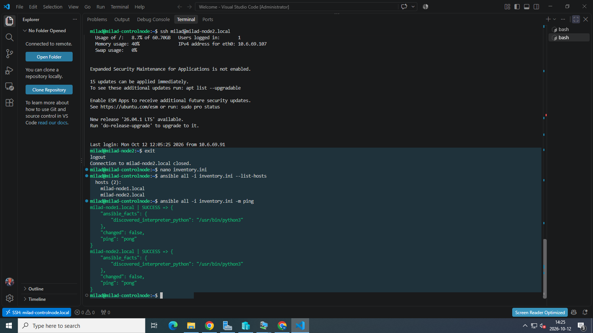

# Lab 1 – Miljöuppsättning SSH

Målet med labben var att sätta upp en enkel Ansible miljö med en kontrollnod och två managed nodes, konfigurera namnuppslagning med mDNS, skapa password less SSH och verifiera att Ansible kan nå båda noderna.


Jag skapade tre Ubuntu Server 24.04.05 virtuella maskiner i Hyper-V:

- `milad-controlnode`
- `milad-node1`
- `milad-node2`


## Genomförande

### 1. Installation och uppdatering
Ubuntu Server 24.04.05 installerades på alla tre maskinerna. Därefter kördes uppdatering av paketlistan.

```bash
sudo apt update
```

Ansible installerades på kontrollnoden.

```bash
sudo apt install -y ansible
```

### 2. mDNS med Avahi
För att kunna använda hostnames med `.local` installerades Avahi på alla noder.

```bash
sudo apt install -y avahi-daemon
sudo systemctl enable --now avahi-daemon
```

Efter detta kunde noderna nås som:

```text
milad-node1.local
milad-node2.local
```

Anslutningen testades med `ping` från kontrollnoden.

### 3. SSH-nyckel
På kontrollnoden skapades ett SSH-nyckelpar.

```bash
ssh-keygen -t ed25519
```

Den publika nyckeln kopierades till båda managed nodes.

```bash
ssh-copy-id milad@milad-node1.local
ssh-copy-id milad@milad-node2.local
```

Därefter verifierades lösenordsfri SSH.

```bash
ssh milad@milad-node1.local
ssh milad@milad-node2.local
```

### 4. Ansible inventory
En inventory fil skapades på kontrollnoden:

```ini
[servers]
milad-node1.local
milad-node2.local
```

För att kontrollera att Ansible hittade båda noderna kördes:

```bash
ansible all -i inventory.ini --list-hosts
```

### 5. Verifiering med Ansible ping
Till sist testades anslutningen med Ansible:

```bash
ansible all -i inventory.ini -m ping
```

Båda noderna svarade med `SUCCESS` och `pong`.

## Resultat
Labben fungerade som förväntat. Kontrollnoden kan nå båda managed nodes via mDNS och SSH, och Ansible kan kommunicera med båda noderna utan lösenord.

## Screenshot

