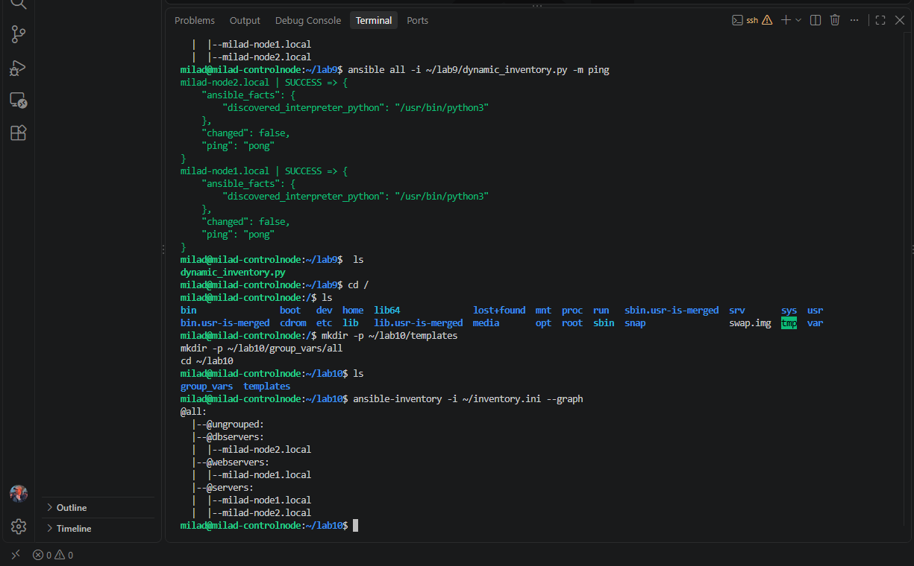
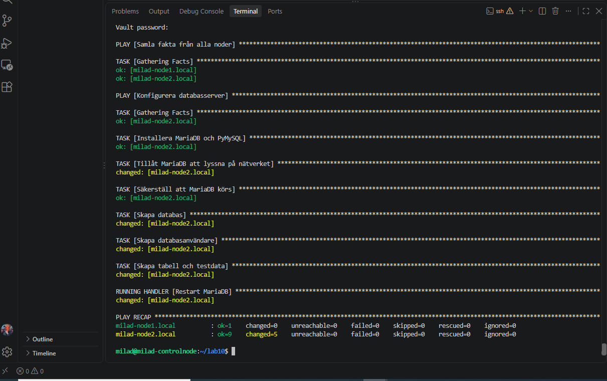
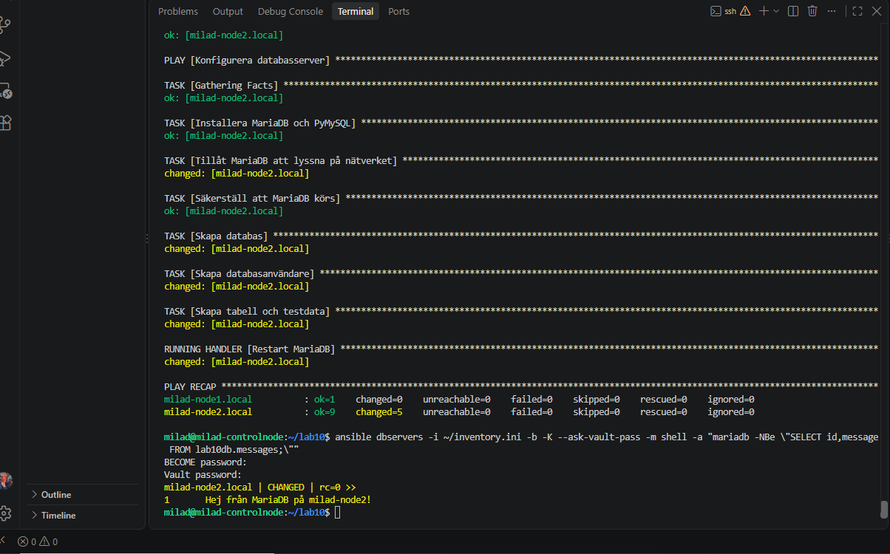
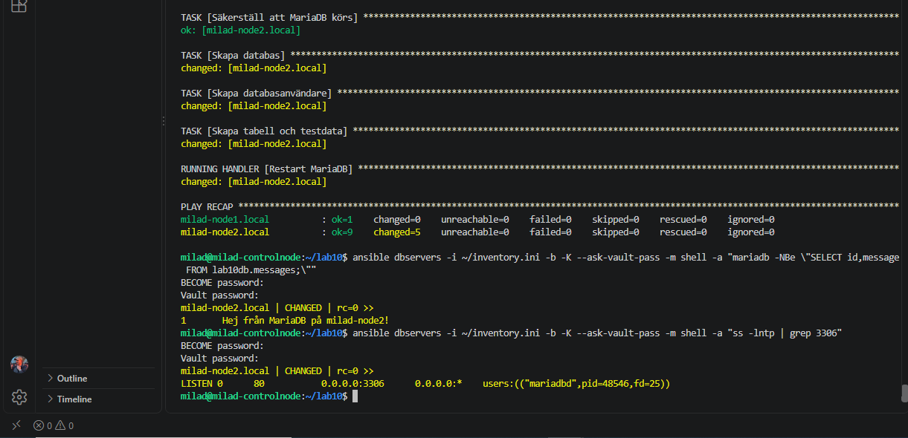
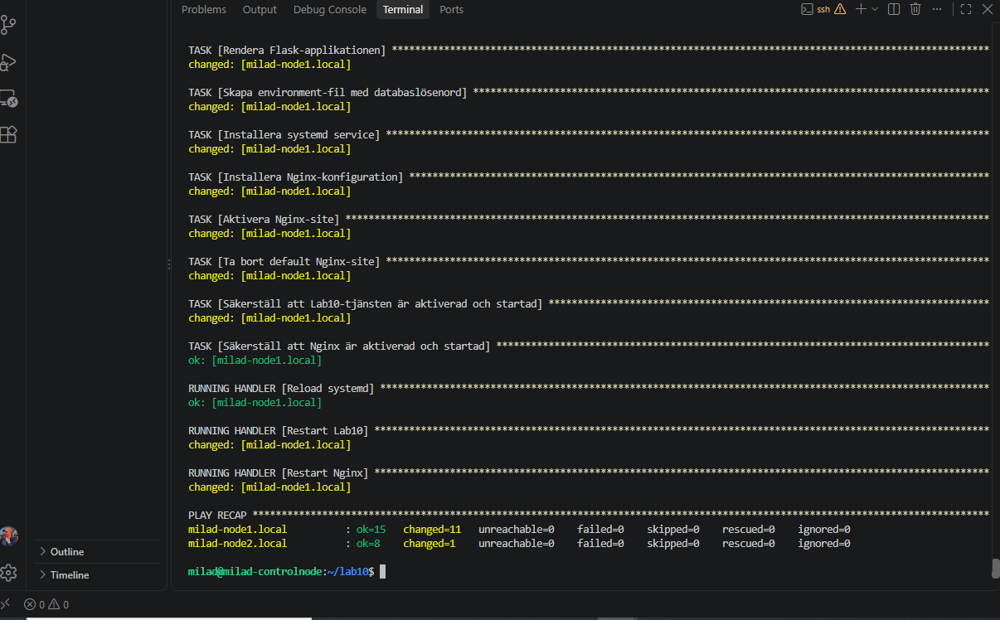
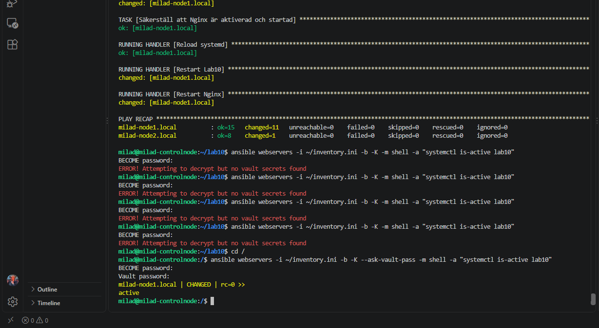
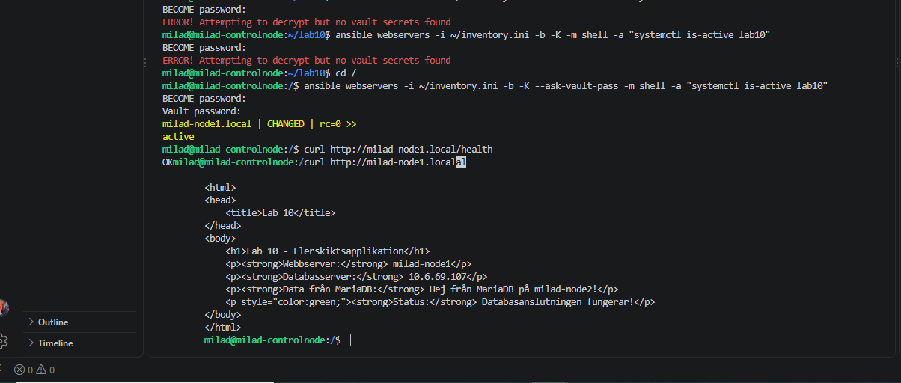
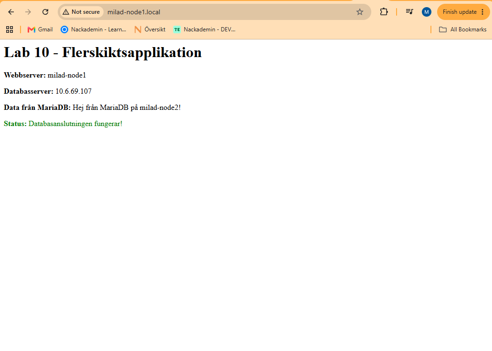

# Lab 10: Driftsättning av flerskiktsapplikation

Målet med labben var att automatisera en applikation som använder två olika servrar.

Jag använde:

- `milad-node1.local` som webb- och applikationsserver
- `milad-node2.local` som databasserver

Applikationen på node1 hämtar data från MariaDB på node2.

Jag gjorde även:

- Flask
- Gunicorn
- Nginx
- MariaDB
- systemd service
- Ansible Vault

---

## Arkitektur

Miljön ser ut så här:

    Webbläsare
        |
        v
    Nginx
    milad-node1.local
        |
        v
    Gunicorn
        |
        v
    Flask
        |
        v
    MariaDB
    milad-node2.local

Webbserver:

    milad-node1.local
    IP: 10.6.69.114

Databasserver:

    milad-node2.local
    IP: 10.6.69.107

---

## 1. Inventory

Jag använde mitt vanliga inventory:

    [dbservers]
    milad-node2.local

    [webservers]
    milad-node1.local

    [servers]
    milad-node1.local
    milad-node2.local

Jag verifierade inventory med:

    ansible-inventory -i ~/inventory.ini --graph

Resultatet visade att:

    webservers -> milad-node1.local
    dbservers  -> milad-node2.local

---

## 2. Mappstruktur

Jag skapade:

    lab10/
    ├── site.yml
    ├── group_vars/
    │   └── all/
    │       └── vault.yml
    └── templates/
        ├── app.py.j2
        ├── lab10.service.j2
        └── nginx-lab10.conf.j2

---

## 3. Ansible Vault

För att inte skriva databaslösenordet i klartext använde jag Ansible Vault.

Jag skapade filen:

    group_vars/all/vault.yml

med:

    ansible-vault create group_vars/all/vault.yml

Innehållet före kryptering var:

    ---
    vault_db_password: "sommar2024"

När jag kontrollerade filen med:

    cat group_vars/all/vault.yml

visades endast krypterad text som började med:

    $ANSIBLE_VAULT;1.1;AES256

Lösenordet kunde därför inte läsas i klartext.

---

## 4. Databasserver  node2

Jag konfigurerade MariaDB på:

    milad-node2.local

Playbooken installerade:

    mariadb-server
    python3-pymysql

MariaDB konfigurerades för att lyssna på nätverket:

    bind-address = 0.0.0.0

Det gör att webbservern på node1 kan ansluta till databasen.

---

## 5. Databas

Jag skapade databasen:

    lab10db

Jag skapade också användaren:

    lab10user

Användaren använder lösenordet från Ansible Vault.

Jag skapade tabellen:

    messages

och lade in testdata:

    id: 1
    message: Hej från MariaDB på milad-node2!

---

## 6. Verifiering av databasen

Jag verifierade att datan fanns med:

    ansible dbservers -i ~/inventory.ini -b -K --ask-vault-pass -m shell -a "mariadb -NBe \"SELECT id,message FROM lab10db.messages;\""

Resultatet blev:

    1    Hej från MariaDB på milad-node2!

Jag verifierade också att MariaDB lyssnade på port 3306:

    ansible dbservers -i ~/inventory.ini -b -K --ask-vault-pass -m shell -a "ss -lntp | grep 3306"

Resultatet visade:

    0.0.0.0:3306

Det betyder att MariaDB accepterar nätverksanslutningar.

---

## 7. Flask applikation

Jag skapade en Jinja2-template:

    templates/app.py.j2

Applikationen använder Flask och PyMySQL.

Den viktiga delen är att databasens IP-adress inte skrivs manuellt.

Ansible hämtar automatiskt IP-adressen från gruppen `dbservers`:

    DB_HOST = "{{ hostvars[groups['dbservers'][0]]['ansible_default_ipv4']['address'] }}"

Applikationen använder:

    DB_USER = "lab10user"
    DB_NAME = "lab10db"

Lösenordet läses från en environment-variabel:

    DB_PASSWORD = os.environ.get("DB_PASSWORD")

Applikationen gör sedan en SQL-fråga:

    SELECT message FROM messages WHERE id = 1

och visar resultatet på webbsidan.

---

## 8. Systemd service

Här kör jag inte Flask manuellt.

Jag skapade:

    templates/lab10.service.j2

Tjänsten använder Gunicorn:

    ExecStart=/usr/bin/gunicorn --workers 2 --bind 127.0.0.1:8000 app:app

Applikationen körs från:

    /opt/lab10

Databaslösenordet läses från:

    /etc/lab10.env

Den filen har begränsade rättigheter:

    0600

Systemd gör också att applikationen startar automatiskt.

---

## 9. Nginx

Jag skapade:

    templates/nginx-lab10.conf.j2

Nginx lyssnar på port:

    80

och skickar trafiken vidare till Gunicorn:

    proxy_pass http://127.0.0.1:8000;

Flödet blir därför:

    Browser -> Nginx -> Gunicorn -> Flask -> MariaDB

---

## 10. Playbook

Huvudfilen är:

    ~/lab10/site.yml

Playbooken arbetar i rätt ordning.

Först samlas facts från båda servrarna.

Sedan konfigureras databasservern.

Efter det konfigureras webbservern.

Det är viktigt eftersom webbapplikationen behöver databasen.

Playbooken kördes med:

    cd ~/lab10
    ansible-playbook -i ~/inventory.ini site.yml -K --ask-vault-pass

Resultatet blev:

    milad-node1.local:
    failed=0
    unreachable=0

    milad-node2.local:
    failed=0
    unreachable=0

---

## 11. Verifiering av systemd

Jag kontrollerade att Lab 10-tjänsten kördes:

    ansible webservers -i ~/inventory.ini -b -K --ask-vault-pass -m shell -a "systemctl is-active lab10"

Resultatet blev:

    active

Det visar att applikationen körs som en systemd service.

---

## 12. Health check

Jag testade:

    curl http://milad-node1.local/health

Resultatet blev:

    OK

Det visar att Flask-applikationen svarar.

---

## 13. Test av hela applikationen

Jag körde:

    curl http://milad-node1.local

Resultatet innehöll:

    Lab 10 - Flerskiktsapplikation

    Webbserver: milad-node1

    Databasserver: 10.6.69.107

    Data från MariaDB: Hej från MariaDB på milad-node2!

    Status: Databasanslutningen fungerar!

Det visar att:

- Nginx fungerar
- Gunicorn fungerar
- Flask fungerar
- systemd-tjänsten fungerar
- node1 kan ansluta till node2
- MariaDB fungerar
- applikationen kan läsa riktig data från databasen

---

## 14. Test i webbläsare

Jag öppnade:

    http://milad-node1.local

Webbsidan visade:

    Lab 10 - Flerskiktsapplikation

    Webbserver: milad-node1

    Databasserver: 10.6.69.107

    Data från MariaDB: Hej från MariaDB på milad-node2!

    Status: Databasanslutningen fungerar!

Detta är den slutliga verifieringen av hela applikationen.

---

## Screenshots

---

## Resultat

Lab 10 fungerade som förväntat.

Jag automatiserade en flerskiktsapplikation med Ansible.

`milad-node1.local` kör:

- Nginx
- Gunicorn
- Flask

`milad-node2.local` kör:

- MariaDB

Ansible konfigurerar databasen först och webbservern efteråt.

Webbservern får databasens IP-adress automatiskt genom Ansible Facts och `hostvars`.

Lösenordet skyddas med Ansible Vault.

Flask körs som en systemd service och använder Gunicorn bakom Nginx.

Slutligen verifierade jag i både terminal och webbläsare att applikationen på node1 kunde hämta data från MariaDB på node2.