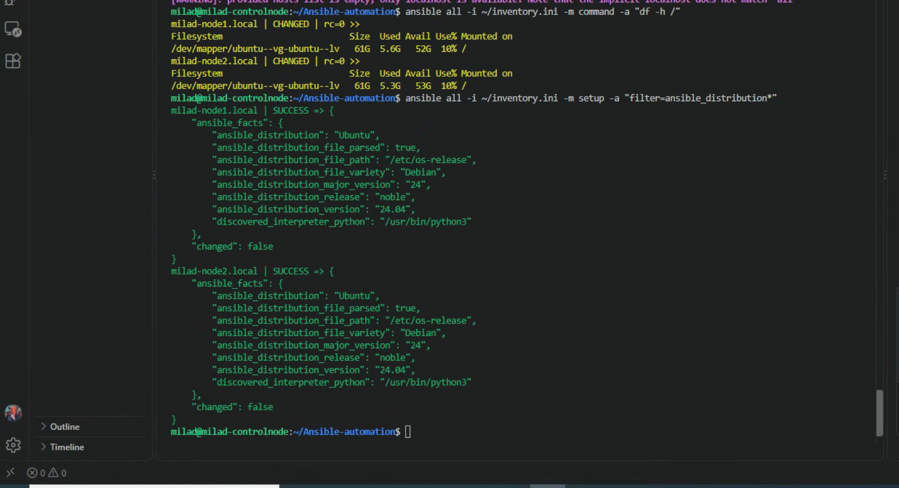

# Lab 2 – Ad-hoc kommandon med Ansible

Målet med labben var att använda Ansible ad-hoc kommandon för att hämta information från båda managed nodes.

De managed nodes som användes var:

- `milad-node1.local`
- `milad-node2.local`

## 1. Kontroll av diskutrymme

Jag körde följande kommando från control node:

    ansible all -i ~/inventory.ini -m command -a "df -h /"

Kommandot kördes på båda noderna och visade diskutrymmet för root-filsystemet `/`.

Båda noderna svarade korrekt.

## 2. Kontroll av Linux distribution

Jag körde följande kommando:

    ansible all -i ~/inventory.ini -m setup -a "filter=ansible_distribution*"

Ansible hämtade facts från båda noderna.

Resultatet visade att båda noderna använder:

- Distribution: Ubuntu
- Version: 24.04
- Release: noble

### Screenshot

## Resultat

Labben fungerade som förväntat.

Jag kunde använda Ansible ad-hoc kommandon för att köra kommandon och hämta systeminformation från flera servrar samtidigt utan att logga in manuellt på varje server.