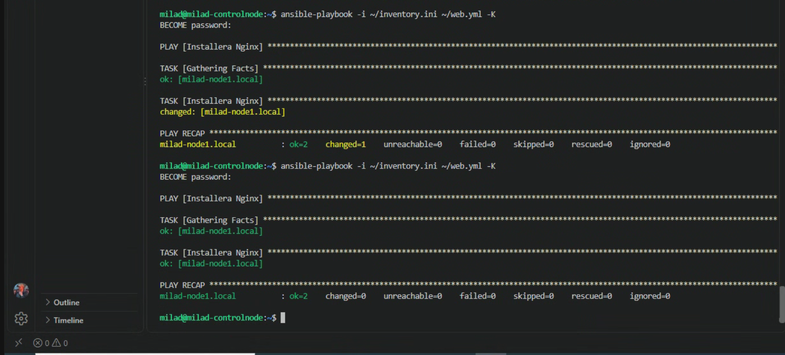
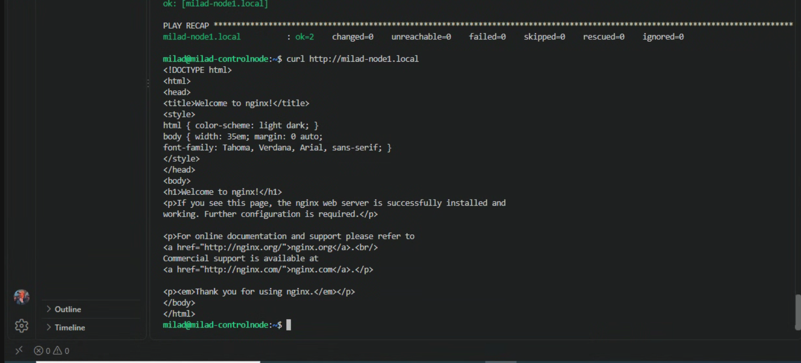

# Lab 3 – Första Playbooken och idempotens

Målet med labben var att skapa en enkel Ansible Playbook som installerar Nginx på en webserver och att förstå begreppet idempotens.

## Inventory

Jag skapade en grupp som heter `webservers` i inventory filen.

    [webservers]
    milad-node1.local

Jag verifierade gruppen med:

    ansible webservers -i ~/inventory.ini --list-hosts

Resultatet visade att `milad-node1.local` tillhör gruppen `webservers`.

## Playbook

Jag skapade filen `web.yml` med följande innehåll:

    ---
    - name: Installera Nginx
      hosts: webservers
      become: true

      tasks:
        - name: Installera Nginx
          ansible.builtin.apt:
            name: nginx
            state: present
            update_cache: yes

## Första körningen

Playbooken kördes med:

    ansible-playbook -i ~/inventory.ini ~/web.yml -K

Eftersom Nginx inte var installerat sedan tidigare gjorde Ansible en ändring på servern.

Resultatet visade:

    changed=1

## Andra körningen

Samma Playbook kördes igen:

    ansible-playbook -i ~/inventory.ini ~/web.yml -K

Den här gången var Nginx redan installerat och servern befann sig redan i önskat tillstånd.

Resultatet visade:

    changed=0

## Idempotens

Idempotens betyder att samma Playbook kan köras flera gånger utan att göra onödiga ändringar om systemet redan är i rätt tillstånd.

Första körningen installerade Nginx och gav `changed=1`.

Andra körningen upptäckte att Nginx redan var installerat och gav därför `changed=0`.

## Screenshots

Testade med curl för att se om det funkar och att ngix var installerad.

och det funkar!

## Resultat

Labben fungerade som förväntat.

Jag skapade min första Ansible Playbook, installerade Nginx på `milad-node1.local` och verifierade idempotens genom att köra samma Playbook två gånger.