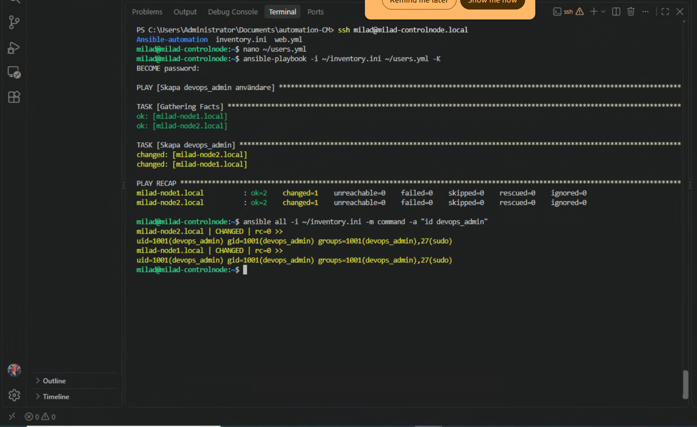
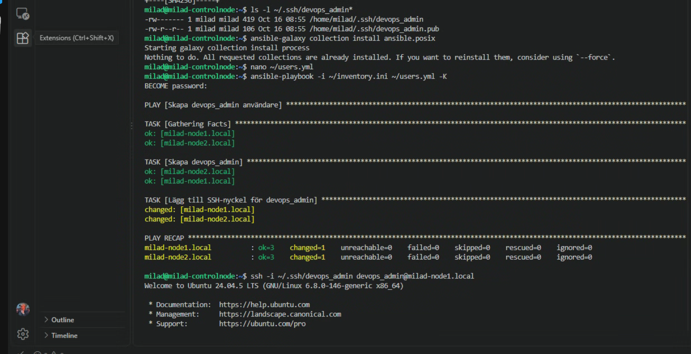
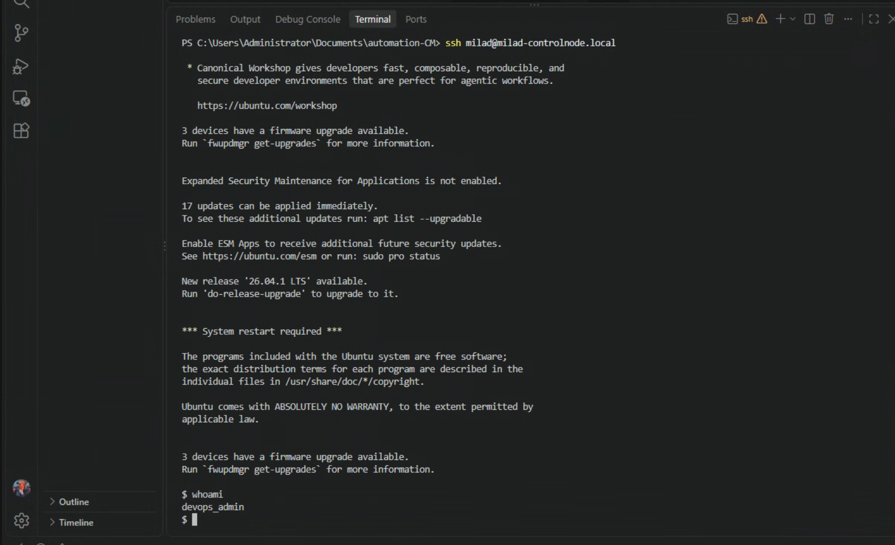
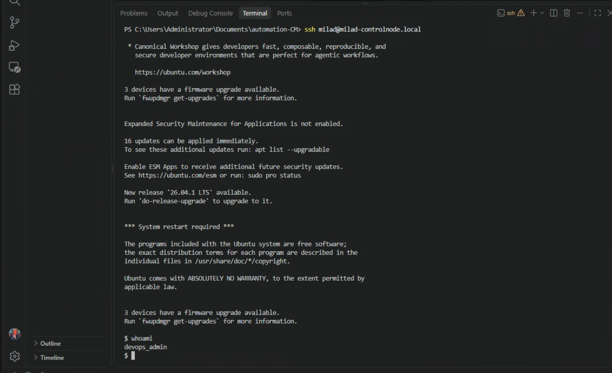

# Lab 4 – Användar och behörighetshantering

Målet med labben var att automatisera skapandet av en ny användare på båda managed nodes, ge användaren sudo behörighet och konfigurera lösenordsfri SSH med en separat SSH-nyckel.

Användaren som skapades var:

devops_admin

Managed nodes:

- milad-node1.local
- milad-node2.local

## 1. Skapa användaren med Ansible

Jag skapade en Playbook som skapar användaren `devops_admin` på båda noderna.

Playbooken innehåller:

    ---
    - name: Skapa devops_admin användare
      hosts: all
      become: true

      tasks:
        - name: Skapa devops_admin
          ansible.builtin.user:
            name: devops_admin
            state: present
            create_home: true
            groups: sudo
            append: true

Playbooken kördes med:

    ansible-playbook -i ~/inventory.ini ~/users.yml -K

Användaren skapades på båda managed nodes.

## 2. Verifiera användaren och sudo-gruppen

Jag verifierade användaren med:

    ansible all -i ~/inventory.ini -m command -a "id devops_admin"

Resultatet visade att `devops_admin` fanns på båda servrarna och tillhörde gruppen `sudo`.

Exempel:

    groups=1001(devops_admin),27(sudo)

## 3. Skapa SSH-nyckel

På control node skapade jag ett separat SSH-nyckelpar för användaren:

    ssh-keygen -t ed25519 -f ~/.ssh/devops_admin -C "devops_admin@controlnode"

Det skapade:

    ~/.ssh/devops_admin
    ~/.ssh/devops_admin.pub

Den privata nyckeln ligger endast på control node.

## 4. Distribuera public key med Ansible

Jag använde `ansible.posix.authorized_key` för att distribuera public key till användaren `devops_admin` på båda managed nodes.

Playbooken uppdaterades med:

    - name: Lägg till SSH-nyckel för devops_admin
      ansible.posix.authorized_key:
        user: devops_admin
        state: present
        key: "{{ lookup('file', lookup('env','HOME') + '/.ssh/devops_admin.pub') }}"

Playbooken kördes igen:

    ansible-playbook -i ~/inventory.ini ~/users.yml -K

SSH-nyckeln lades till på båda noderna.

## 5. Verifiera lösenordsfri SSH

Jag testade inloggning med den nya SSH-nyckeln:

    ssh -i ~/.ssh/devops_admin devops_admin@milad-node1.local

och:

    ssh -i ~/.ssh/devops_admin devops_admin@milad-node2.local

Efter inloggning verifierade jag användaren med:

    whoami

Resultatet var:

    devops_admin

Inloggningen fungerade utan lösenord.

## Screenshots

## Resultat

Labben fungerade som förväntat.

Jag automatiserade skapandet av användaren `devops_admin` på båda managed nodes, lade till användaren i sudo-gruppen, skapade en separat SSH-nyckel och distribuerade public key med Ansible.

Jag verifierade sedan att `devops_admin` kunde logga in på servrarna via SSH utan lösenord.