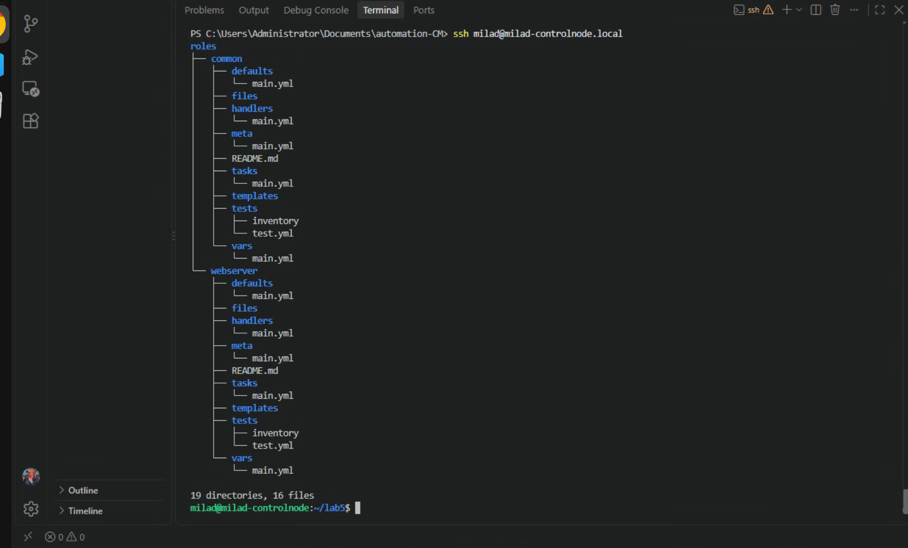
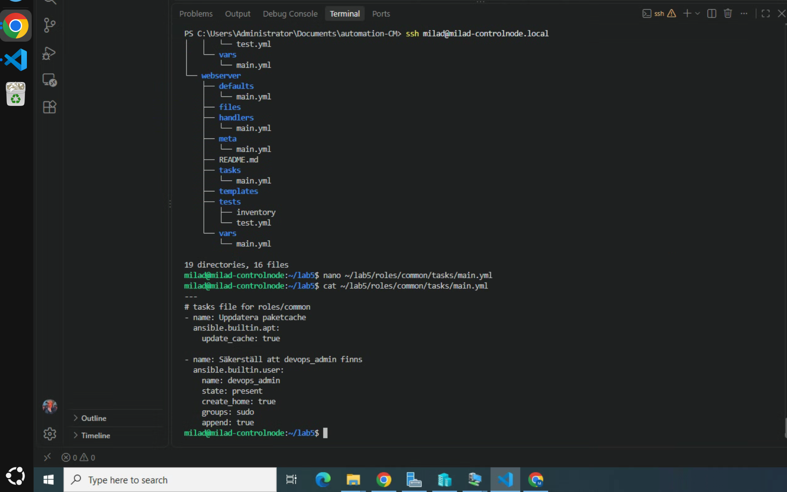
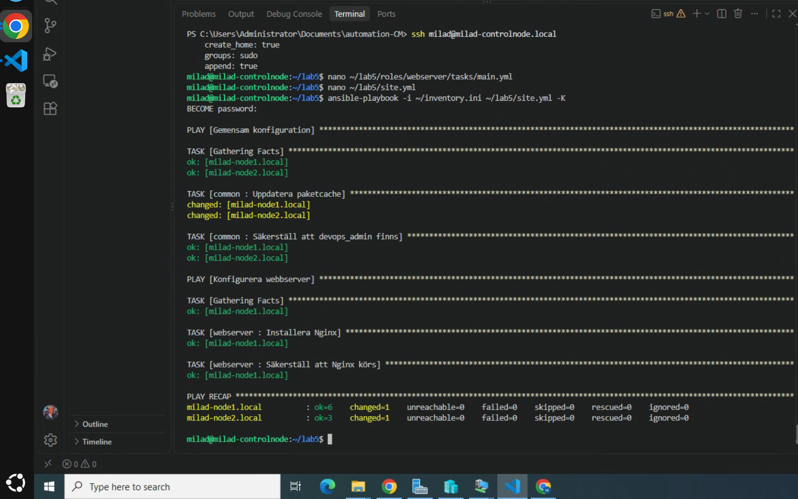

# Lab 5 – Strukturering med Ansible Roles

Målet med labben var att strukturera Ansible koden med hjälp av Roles för att göra lösningen mer modulär, återanvändbar och lättare att underhålla.

Jag skapade två roller:

- `common`
- `webserver`

`common` innehåller generell konfiguration som ska gälla flera noder.

`webserver` innehåller konfiguration som endast gäller webbservern.

## 1. Skapa roller

Rollstrukturen skapades med:

    ansible-galaxy role init roles/common
    ansible-galaxy role init roles/webserver

Det skapade en standardiserad mappstruktur med bland annat:

    tasks/
    handlers/
    templates/
    defaults/
    vars/

## 2. Common role

I `roles/common/tasks/main.yml` lade jag generell konfiguration:

    ---
    - name: Uppdatera paketcache
      ansible.builtin.apt:
        update_cache: true

    - name: Säkerställ att devops_admin finns
      ansible.builtin.user:
        name: devops_admin
        state: present
        create_home: true
        groups: sudo
        append: true

Denna roll används för båda managed nodes.

## 3. Webserver role

I `roles/webserver/tasks/main.yml` lade jag webbserver-konfiguration:

    ---
    - name: Installera Nginx
      ansible.builtin.package:
        name: nginx
        state: present

    - name: Säkerställ att Nginx körs
      ansible.builtin.service:
        name: nginx
        state: started
        enabled: true

Denna roll används endast på gruppen `webservers`.

## 4. Huvud-Playbook

Jag skapade `site.yml` som anropar båda rollerna:

    ---
    - name: Gemensam konfiguration
      hosts: all
      become: true

      roles:
        - common

    - name: Konfigurera webbserver
      hosts: webservers
      become: true

      roles:
        - webserver

## 5. Körning

Playbooken kördes med:

    ansible-playbook -i ~/inventory.ini ~/lab5/site.yml -K

Resultatet visade att `common` kördes på:

    milad-node1.local
    milad-node2.local

och att `webserver` endast kördes på:

    milad-node1.local

Körningen slutfördes utan fel.

## 6. Rollstruktur

Jag verifierade rollstrukturen med:

    tree roles

Det visade den standardiserade Ansible-strukturen för både `common` och `webserver`.

## Screenshots

## Resultat

Labben fungerade som förväntat.

Jag lärde mig hur Ansible Roles används för att dela upp automation i återanvändbara delar istället för att lägga all logik i en enda Playbook.

`common` hanterar generell konfiguration och `webserver` hanterar webbserver-specifika uppgifter, medan `site.yml` fungerar som huvudfil som anropar rollerna.# Lab 5 – Strukturering med Ansible Roles

## Mål

Målet med labben var att strukturera Ansible-koden med hjälp av Roles för att göra lösningen mer modulär, återanvändbar och lättare att underhålla.

Jag skapade två roller:

- `common`
- `webserver`

`common` innehåller generell konfiguration som ska gälla flera noder.

`webserver` innehåller konfiguration som endast gäller webbservern.

## 1. Skapa roller

Rollstrukturen skapades med:

    ansible-galaxy role init roles/common
    ansible-galaxy role init roles/webserver

Det skapade en standardiserad mappstruktur med bland annat:

    tasks/
    handlers/
    templates/
    defaults/
    vars/

## 2. Common role

I `roles/common/tasks/main.yml` lade jag generell konfiguration:

    ---
    - name: Uppdatera paketcache
      ansible.builtin.apt:
        update_cache: true

    - name: Säkerställ att devops_admin finns
      ansible.builtin.user:
        name: devops_admin
        state: present
        create_home: true
        groups: sudo
        append: true

Denna roll används för båda managed nodes.

## 3. Webserver role

I `roles/webserver/tasks/main.yml` lade jag webbserver-konfiguration:

    ---
    - name: Installera Nginx
      ansible.builtin.package:
        name: nginx
        state: present

    - name: Säkerställ att Nginx körs
      ansible.builtin.service:
        name: nginx
        state: started
        enabled: true

Denna roll används endast på gruppen `webservers`.

## 4. Huvud Playbook

Jag skapade `site.yml` som anropar båda rollerna:

    ---
    - name: Gemensam konfiguration
      hosts: all
      become: true

      roles:
        - common

    - name: Konfigurera webbserver
      hosts: webservers
      become: true

      roles:
        - webserver

## 5. Körning

Playbooken kördes med:

    ansible-playbook -i ~/inventory.ini ~/lab5/site.yml -K

Resultatet visade att `common` kördes på:

    milad-node1.local
    milad-node2.local

och att `webserver` endast kördes på:

    milad-node1.local

Körningen slutfördes utan fel.

## 6. Rollstruktur

Jag verifierade rollstrukturen med:

    tree roles

Det visade den standardiserade Ansible-strukturen för både `common` och `webserver`.

## Resultat

Labben fungerade som förväntat.

Jag lärde mig hur Ansible Roles används för att dela upp automation i återanvändbara delar istället för att lägga all logik i en enda Playbook.

`common` hanterar generell konfiguration och `webserver` hanterar webbserver-specifika uppgifter, medan `site.yml` fungerar som huvudfil som anropar rollerna.