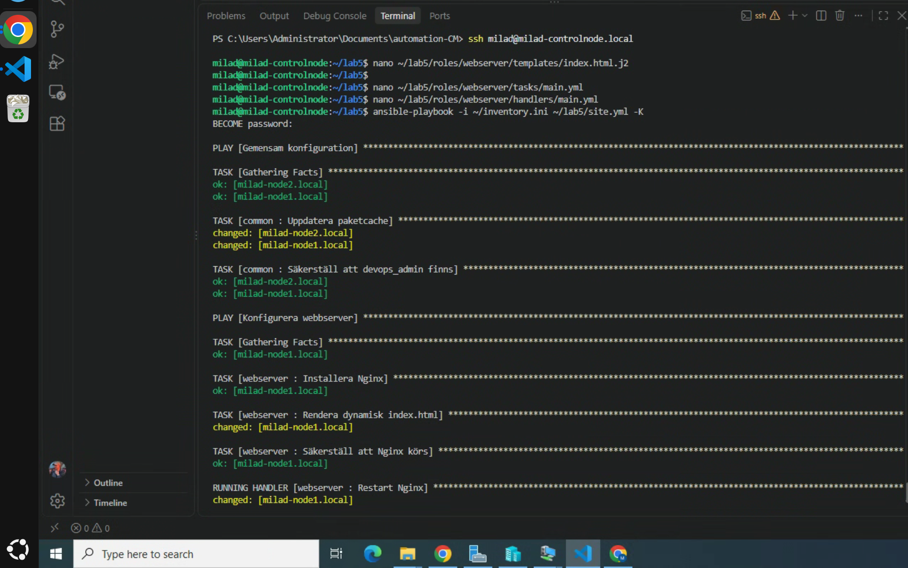
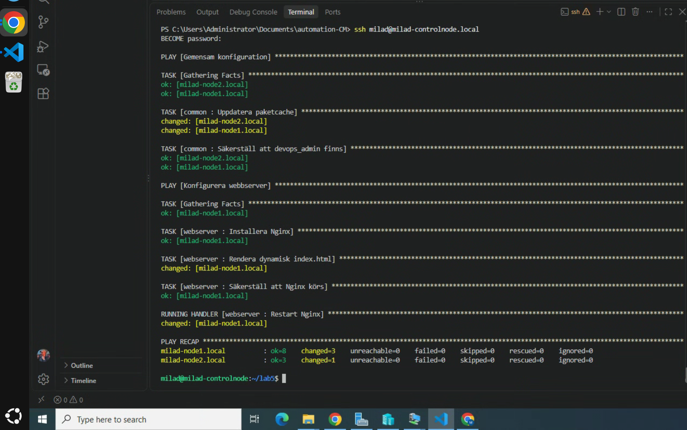
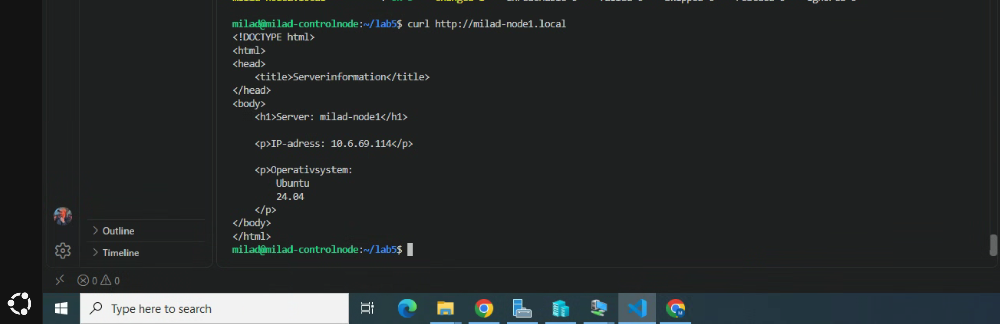
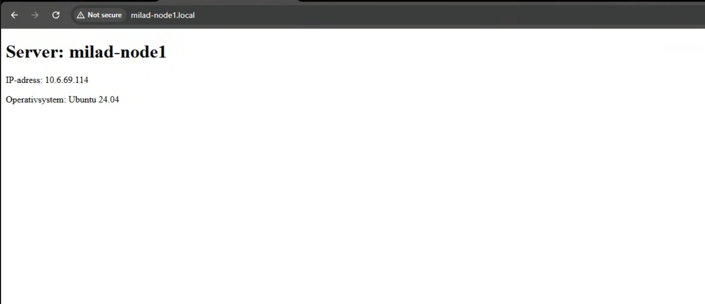

# Lab 6 – Dynamiska konfigurationsfiler med Jinja2

Målet med labben var att använda Jinja2 tillsammans med Ansible Facts för att skapa en dynamisk HTML sida och distribuera den till webbservern.

Jag använde rollen `webserver` från tidigare labb och lade till en Jinja2 template samt en handler för Nginx.

## 1. Jinja2-template

Jag skapade filen:

    roles/webserver/templates/index.html.j2

Template-filen innehåller dynamiska värden från Ansible Facts:

    <!DOCTYPE html>
    <html>
    <head>
        <title>Serverinformation</title>
    </head>
    <body>
        <h1>Server: {{ ansible_facts['hostname'] }}</h1>

        
IP-adress: {{ ansible_facts['default_ipv4']['address'] }}

        
Operativsystem:
            {{ ansible_facts['distribution'] }}
            {{ ansible_facts['distribution_version'] }}
        

    </body>
    </html>

Ansible ersätter värdena mellan `{{ }}` med information från den aktuella servern.

## 2. Template-task i rollen

I `roles/webserver/tasks/main.yml` lade jag till:

    - name: Rendera dynamisk index.html
      ansible.builtin.template:
        src: index.html.j2
        dest: /var/www/html/index.html
      notify: Restart Nginx

Tasken använder `ansible.builtin.template` för att rendera Jinja2-filen och kopiera den färdiga HTML-filen till webbservern.

## 3. Handler

Jag skapade en handler i:

    roles/webserver/handlers/main.yml

Innehåll:

    ---
    - name: Restart Nginx
      ansible.builtin.service:
        name: nginx
        state: restarted

Handlern körs endast när template-filen ändras.

## 4. Körning

Playbooken kördes med:

    ansible-playbook -i ~/inventory.ini ~/lab5/site.yml -K

Resultatet visade att Jinja2-template ändrades:

    changed: [milad-node1.local]

och att handlern därefter kördes:

    RUNNING HANDLER [webserver : Restart Nginx]

Körningen slutfördes utan fel.

## 5. Verifiering med curl

Jag testade sidan från control node:

    curl http://milad-node1.local

Resultatet visade genererad HTML med riktiga värden från servern:

    Server: milad-node1
    IP-adress: 10.6.69.114
    Operativsystem: Ubuntu 24.04

## 6. Verifiering i webbläsare

Jag öppnade:

    http://milad-node1.local

i webbläsaren.

Sidan visade dynamiskt:

- Servernamn
- IP-adress
- Operativsystem
- OS-version

## Screenshots

## Resultat

Labben fungerade som förväntat.

Jag använde Jinja2 tillsammans med Ansible Facts för att generera en dynamisk HTML-sida.

Jag lärde mig också hur `ansible.builtin.template` används och hur en handler kan triggas automatiskt när en konfigurationsfil ändras.