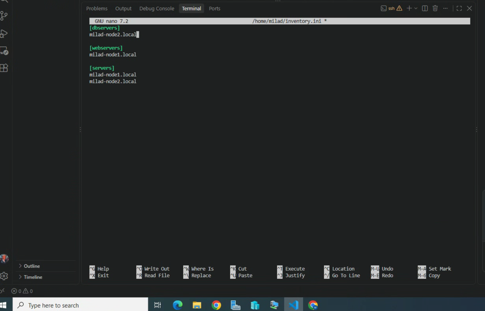
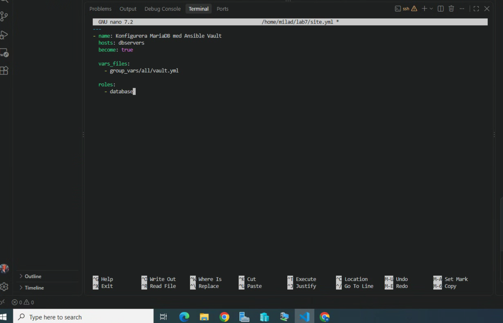
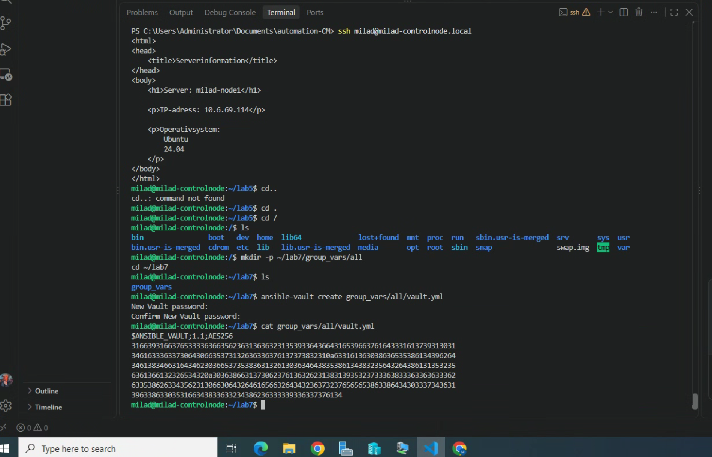
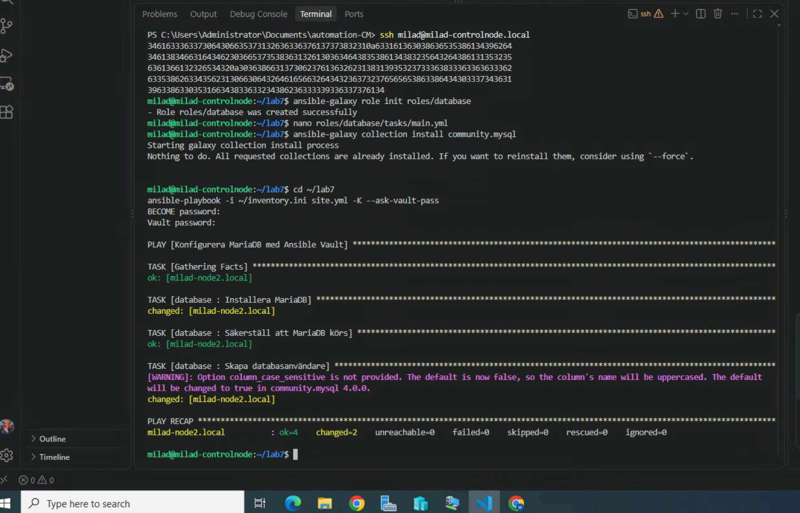
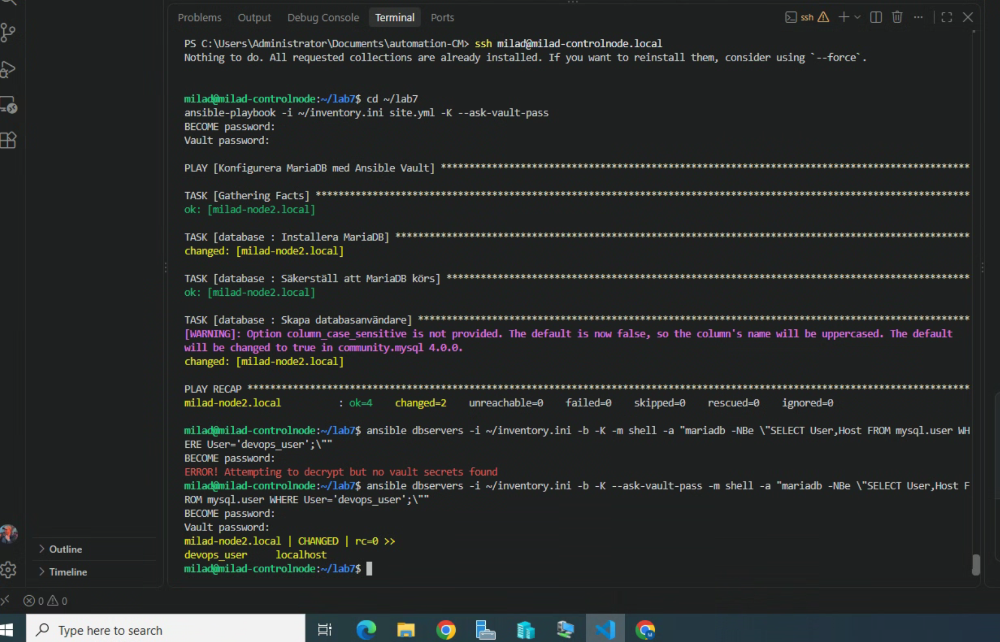

# Lab 7 – Secrets Management med Ansible Vault

Målet med labben var att lära mig hur känsliga värden kan lagras säkert i Ansible med hjälp av Ansible Vault.

Jag gjorde labben på VG nivå genom att:

- skapa en krypterad Vault fil
- lagra databaslösenordet krypterat
- installera MariaDB via en Ansible Role
- skapa en databasanvändare med lösenordet från Vault
- verifiera att databasanvändaren skapades korrekt

## 1. Skapa Vault fil

Jag skapade först mappstrukturen:

    mkdir -p ~/lab7/group_vars/all
    cd ~/lab7

Sedan skapade jag den krypterade filen:

    ansible-vault create group_vars/all/vault.yml

I filen lade jag in:

    ---
    vault_db_password: "sommar2024"

När filen sparades krypterades innehållet automatiskt av Ansible Vault.

Jag verifierade detta med:

    cat group_vars/all/vault.yml

Resultatet började med:

    $ANSIBLE_VAULT;1.1;AES256

Det riktiga lösenordet gick alltså inte att läsa i råformat.

## 2. Skapa databasgrupp i inventory

Jag lade till en separat grupp för databasservern i `inventory.ini`:

    [dbservers]
    milad-node2.local

Jag använde `milad-node2.local` som databasserver.

## 3. Skapa database-role

Jag skapade rollen med:

    ansible-galaxy role init roles/database

Sedan uppdaterade jag:

    roles/database/tasks/main.yml

med följande innehåll:

    ---
    - name: Installera MariaDB
      ansible.builtin.apt:
        name:
          - mariadb-server
          - python3-pymysql
        state: present
        update_cache: true

    - name: Säkerställ att MariaDB körs
      ansible.builtin.service:
        name: mariadb
        state: started
        enabled: true

    - name: Skapa databasanvändare
      community.mysql.mysql_user:
        name: devops_user
        password: "{{ vault_db_password }}"
        priv: "*.*:ALL"
        host: localhost
        state: present
        login_unix_socket: /run/mysqld/mysqld.sock

Jag verifierade även att MySQL-collection fanns installerad:

    ansible-galaxy collection install community.mysql

## 4. Skapa huvud Playbook

Jag skapade filen:

    ~/lab7/site.yml

med följande innehåll:

    ---
    - name: Konfigurera MariaDB med Ansible Vault
      hosts: dbservers
      become: true

      vars_files:
        - group_vars/all/vault.yml

      roles:
        - database

Playbooken använder alltså den krypterade Vault-filen för att läsa in variabeln `vault_db_password`.

## 5. Kör Playbooken

Jag körde:

    cd ~/lab7
    ansible-playbook -i ~/inventory.ini site.yml -K --ask-vault-pass

Jag fick ange:

    BECOME password:
    Vault password:

Playbooken installerade MariaDB, startade tjänsten och skapade databasanvändaren `devops_user`.

Resultatet visade:

    failed=0

## 6. Verifiera databasanvändaren

Jag verifierade att användaren skapades med:

    ansible dbservers -i ~/inventory.ini -b -K --ask-vault-pass -m shell -a "mariadb -NBe \"SELECT User,Host FROM mysql.user WHERE User='devops_user';\""

Resultatet visade:

    devops_user    localhost

Det bevisar att databasanvändaren skapades korrekt.

## 7. Säkerhet

Databaslösenordet finns inte i klartext i Playbooken eller i role-filerna.

Det ligger istället i:

    group_vars/all/vault.yml

och filen är krypterad med Ansible Vault.

Det betyder att filen kan versionshanteras i Git utan att själva lösenordet visas i klartext.

## Screenshots
grupp för databasservern

## Resultat

Labben fungerade som förväntat.

Jag använde Ansible Vault för att lagra ett känsligt lösenord krypterat och använde sedan lösenordet i en Ansible Role för att skapa en MariaDB-användare.

Jag verifierade både att Vault-filen var oläsbar i råformat och att databasanvändaren `devops_user` skapades korrekt på `milad-node2.local`.