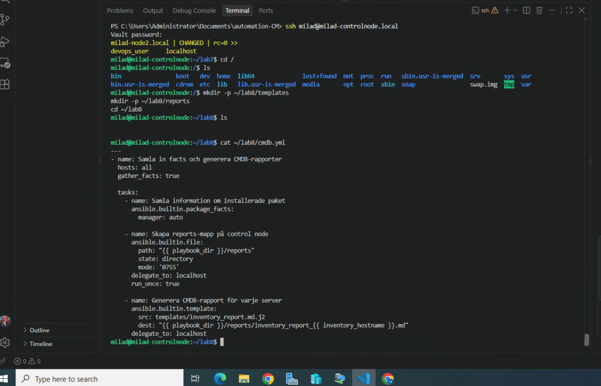
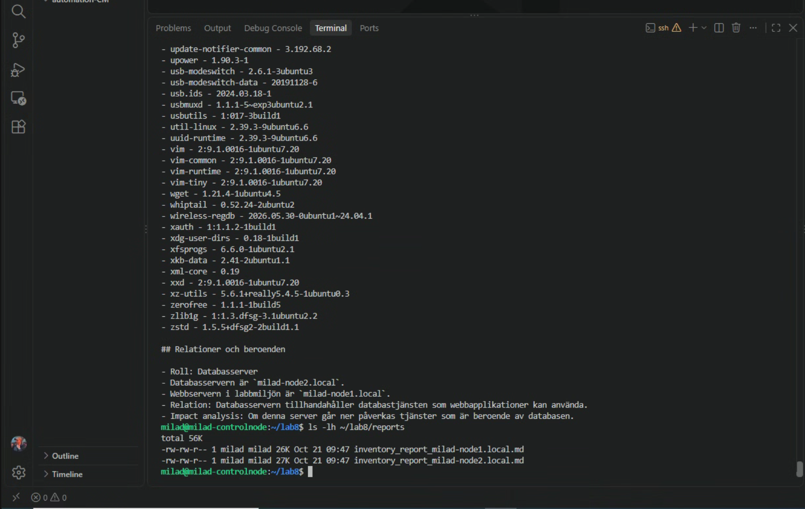
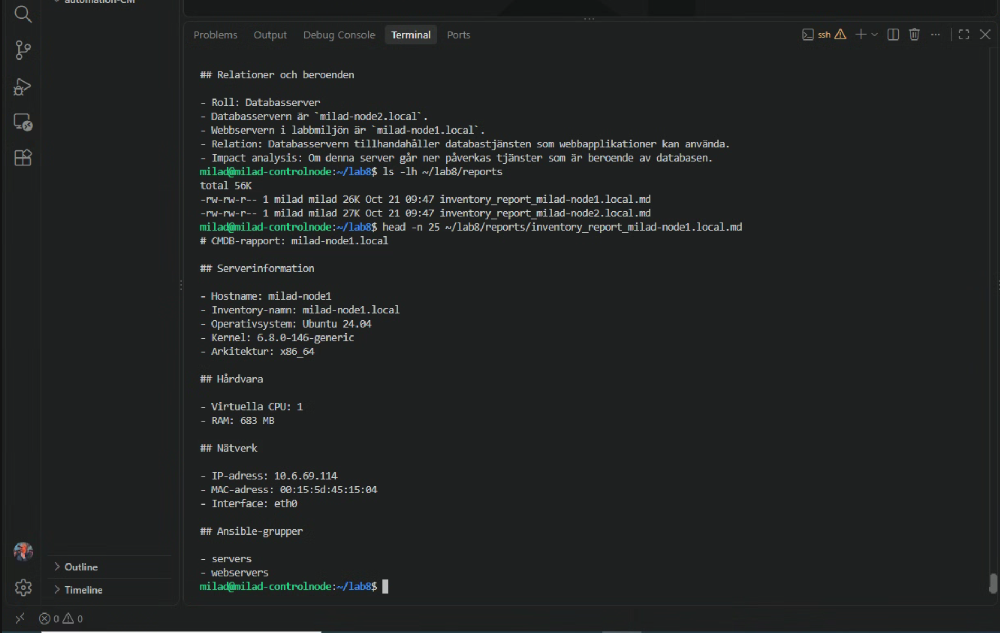
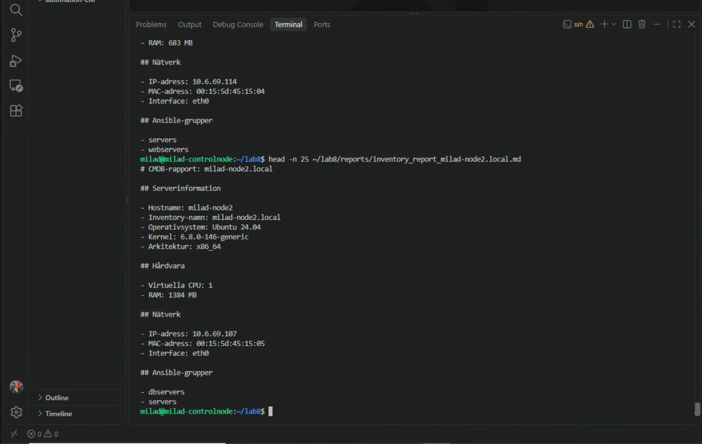
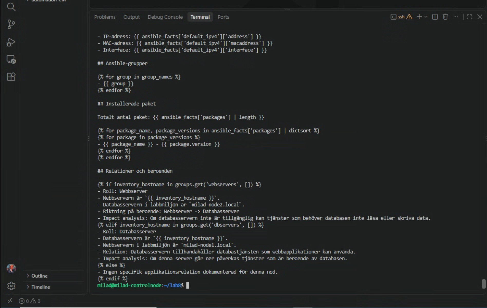

# Lab 8 – CMDB och Configuration Items

Målet med labben var att förstå hur information om infrastrukturen kan samlas in automatiskt och dokumenteras som Configuration Items (CIs).

Jag använde Ansible Facts och package facts för att samla information från mina managed nodes och genererade sedan automatiskt en Markdown-rapport för varje server.

Jag genomförde även VG delen genom att dokumentera relationen och beroendet mellan webbservern och databasservern.

Managed nodes:

- milad-node1.local – Webbserver
- milad-node2.local – Databasserver

## 1. Skapa mappstruktur

Jag skapade följande struktur:

    lab8/
    ├── cmdb.yml
    ├── templates/
    │   └── inventory_report.md.j2
    └── reports/

Kommandon:

    mkdir -p ~/lab8/templates
    mkdir -p ~/lab8/reports
    cd ~/lab8

## 2. CMDB Playbook

Jag skapade:

    ~/lab8/cmdb.yml

med följande innehåll:

    ---
    - name: Samla in facts och generera CMDB-rapporter
      hosts: all
      gather_facts: true

      tasks:
        - name: Samla information om installerade paket
          ansible.builtin.package_facts:
            manager: auto

        - name: Skapa reports-mapp på control node
          ansible.builtin.file:
            path: "{{ playbook_dir }}/reports"
            state: directory
            mode: '0755'
          delegate_to: localhost
          run_once: true

        - name: Generera CMDB-rapport för varje server
          ansible.builtin.template:
            src: templates/inventory_report.md.j2
            dest: "{{ playbook_dir }}/reports/inventory_report_{{ inventory_hostname }}.md"
          delegate_to: localhost

`gather_facts: true` används för att samla systeminformation från servrarna.

`ansible.builtin.package_facts` samlar information om installerade paket.

`delegate_to: localhost` gör att rapporterna sparas centralt på control node istället för på managed nodes.

## 3. Jinja2-template för rapporterna

Jag skapade:

    ~/lab8/templates/inventory_report.md.j2

med följande innehåll:

    # CMDB-rapport: {{ inventory_hostname }}

    ## Serverinformation

    - Hostname: {{ ansible_facts['hostname'] }}
    - Inventory-namn: {{ inventory_hostname }}
    - Operativsystem: {{ ansible_facts['distribution'] }} {{ ansible_facts['distribution_version'] }}
    - Kernel: {{ ansible_facts['kernel'] }}
    - Arkitektur: {{ ansible_facts['architecture'] }}

    ## Hårdvara

    - Virtuella CPU: {{ ansible_facts['processor_vcpus'] }}
    - RAM: {{ ansible_facts['memtotal_mb'] }} MB

    ## Nätverk

    - IP-adress: {{ ansible_facts['default_ipv4']['address'] }}
    - MAC-adress: {{ ansible_facts['default_ipv4']['macaddress'] }}
    - Interface: {{ ansible_facts['default_ipv4']['interface'] }}

    ## Ansible-grupper

    
    - {{ group }}
    

    ## Installerade paket

    Totalt antal paket: {{ ansible_facts['packages'] | length }}

    
    
    - {{ package_name }} - {{ package.version }}
    
    

    ## Relationer och beroenden

    
    - Roll: Webbserver
    - Webbservern är `{{ inventory_hostname }}`.
    - Databasservern i labbmiljön är `milad-node2.local`.
    - Riktning på beroende: Webbserver -> Databasserver
    - Impact analysis: Om databasservern inte är tillgänglig kan tjänster som behöver databasen inte läsa eller skriva data.
    
    - Roll: Databasserver
    - Databasservern är `{{ inventory_hostname }}`.
    - Webbservern i labbmiljön är `milad-node1.local`.
    - Relation: Databasservern tillhandahåller databastjänsten som webbapplikationer kan använda.
    - Impact analysis: Om denna server går ner påverkas tjänster som är beroende av databasen.
    
    - Ingen specifik applikationsrelation dokumenterad för denna nod.
    

## 4. Köra Playbooken

Jag körde:

    cd ~/lab8
    ansible-playbook -i ~/inventory.ini cmdb.yml

Ansible samlade automatiskt in facts och installerade paket från båda servrarna.

Rapporterna genererades på control node.

## 5. Genererade rapporter

Jag verifierade rapporterna med:

    ls -lh ~/lab8/reports

Två rapporter skapades:

    inventory_report_milad-node1.local.md
    inventory_report_milad-node2.local.md

Rapporterna innehåller aktuell information om respektive server.

## 6. Verifiering av node1

Jag kontrollerade rapporten med:

    head -n 25 ~/lab8/reports/inventory_report_milad-node1.local.md

Rapporten visade bland annat:

    Hostname: milad-node1
    Inventory-namn: milad-node1.local
    Operativsystem: Ubuntu 24.04
    Kernel: 6.8.0-146-generic
    Arkitektur: x86_64

    Virtuella CPU: 1
    RAM: 683 MB

    IP-adress: 10.6.69.114
    MAC-adress: 00:15:5d:45:15:04
    Interface: eth0

Ansible-grupper:

    servers
    webservers

## 7. Verifiering av node2

Jag kontrollerade rapporten med:

    head -n 25 ~/lab8/reports/inventory_report_milad-node2.local.md

Rapporten visade bland annat:

    Hostname: milad-node2
    Inventory-namn: milad-node2.local
    Operativsystem: Ubuntu 24.04
    Kernel: 6.8.0-146-generic
    Arkitektur: x86_64

    Virtuella CPU: 1
    RAM: 1384 MB

    IP-adress: 10.6.69.107
    MAC-adress: 00:15:5d:45:15:05
    Interface: eth0

Ansible-grupper:

    dbservers
    servers

## 8. Installerade paket

Playbooken använder:

    ansible.builtin.package_facts

för att automatiskt samla information om installerade paket.

Rapporterna innehåller därför även en lista över installerade paket och deras versioner.

Det gör att mjukvara på servrarna också dokumenteras som Configuration Items.

## 9. VG – Relationer och beroenden

Jag dokumenterade relationerna mellan servrarna.

Miljön består av:

    milad-node1.local
        |
        | Webbserver -> Databasserver
        v
    milad-node2.local

Node1 har rollen webbserver.

Node2 har rollen databasserver och kör MariaDB.

Beroenderiktningen dokumenteras som:

    Webbserver -> Databasserver

Impact analysis:

Om databasservern går ner kan tjänster som är beroende av databasen inte läsa eller skriva data.

Detta visar varför relationer mellan Configuration Items är viktiga i en CMDB.

## 10. Koppling till CMDB

Ett Configuration Item är en komponent i infrastrukturen som behöver dokumenteras och hanteras.

I denna labb samlade jag bland annat in:

- Servrar
- Hostname
- Operativsystem
- OS-version
- Kernel
- CPU
- RAM
- IP-adress
- MAC-adress
- Nätverksinterface
- Installerade paket
- Ansible-grupper
- Serverroller
- Relationer och beroenden

Istället för att dokumentera informationen manuellt hämtar Ansible informationen direkt från servrarna.

När Playbooken körs igen genereras rapporterna på nytt med aktuell information.

Det minskar risken för att dokumentationen inte längre stämmer med den verkliga infrastrukturen.

## Screenshots

## Resultat

Labben fungerade som förväntat.

Jag använde Ansible Facts, package facts och Jinja2 för att automatiskt samla in Configuration Items från båda servrarna och generera centrala Markdown-rapporter på control node.

Jag dokumenterade även relationen mellan webbservern och databasservern samt gjorde en impact analysis.

Labben genomfördes därför även med VG-delen.