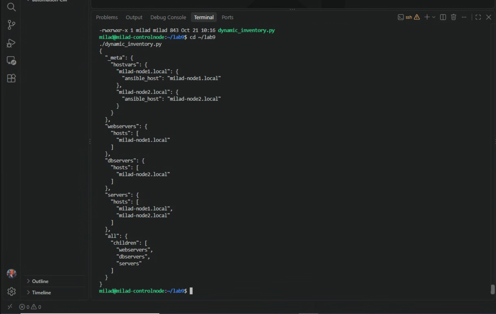
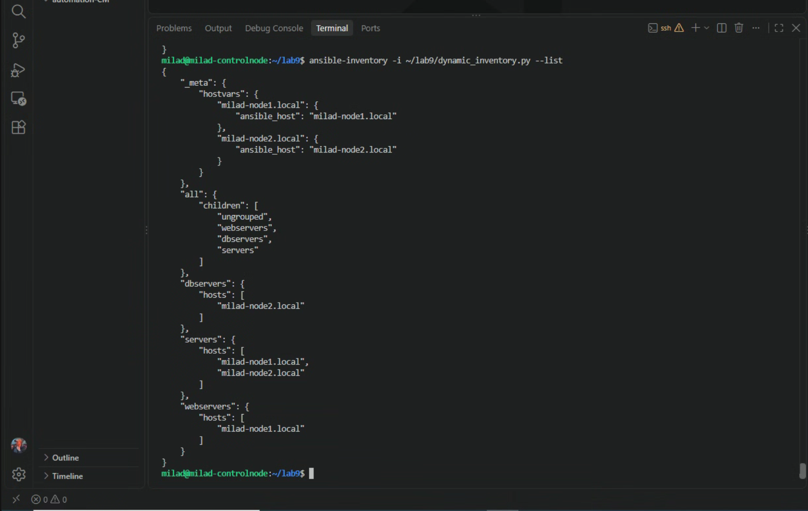
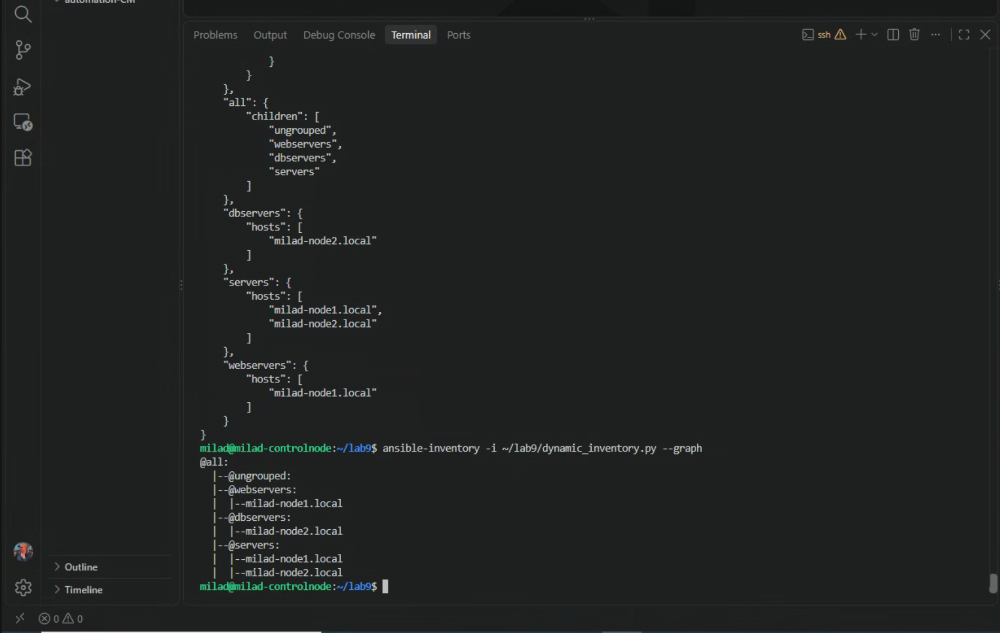
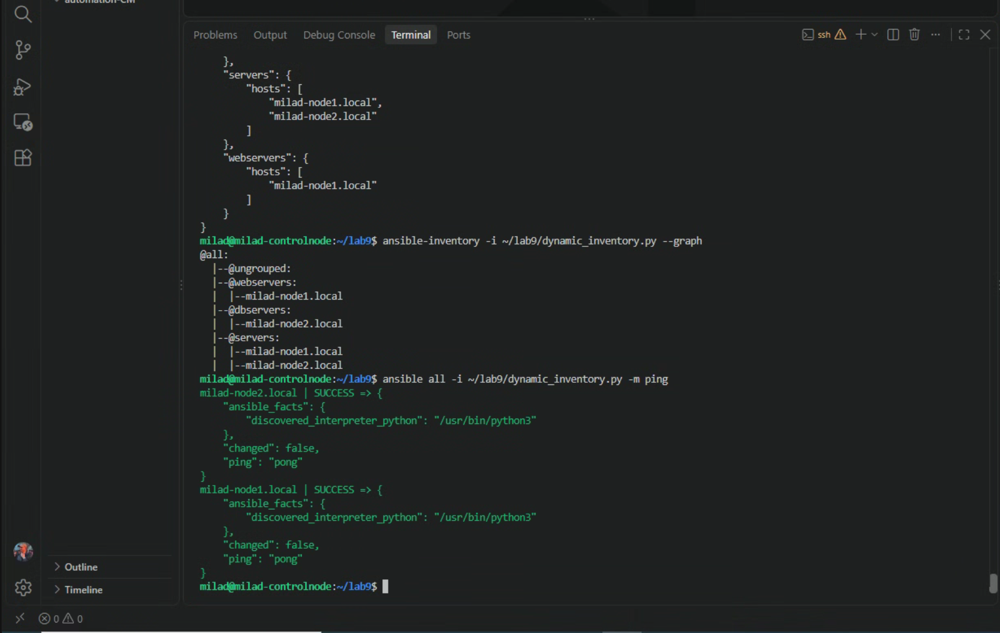

# Lab 9 – Dynamisk Inventory med Ansible

Målet med labben var att förstå hur Ansible kan använda ett dynamiskt inventory istället för en statisk inventory-fil.

Jag skapade ett Python-script som returnerar inventory-information i JSON-format.

Scriptet innehåller mina två managed nodes och delar in dem i grupperna:

- webservers
- dbservers
- servers

## 1. Skapa Lab 9-mapp

Jag skapade en separat mapp för labben:

    mkdir -p ~/lab9
    cd ~/lab9

## 2. Skapa dynamiskt inventory

Jag skapade filen:

    dynamic_inventory.py

med följande innehåll:

    #!/usr/bin/env python3

    import json
    import sys

    inventory = {
        "_meta": {
            "hostvars": {
                "milad-node1.local": {
                    "ansible_host": "milad-node1.local"
                },
                "milad-node2.local": {
                    "ansible_host": "milad-node2.local"
                }
            }
        },

        "webservers": {
            "hosts": [
                "milad-node1.local"
            ]
        },

        "dbservers": {
            "hosts": [
                "milad-node2.local"
            ]
        },

        "servers": {
            "hosts": [
                "milad-node1.local",
                "milad-node2.local"
            ]
        },

        "all": {
            "children": [
                "webservers",
                "dbservers",
                "servers"
            ]
        }
    }

    if "--host" in sys.argv:
        print(json.dumps({}))
    else:
        print(json.dumps(inventory, indent=2))

## 3. Göra scriptet körbart

För att Ansible skulle kunna använda scriptet gjorde jag det körbart:

    chmod +x dynamic_inventory.py

Jag verifierade rättigheterna med:

    ls -l dynamic_inventory.py

Resultatet visade att filen hade execute-rättighet.

Exempel:

    -rwxrwxr-x

## 4. Testa scriptet direkt

Jag körde:

    ./dynamic_inventory.py

Scriptet returnerade JSON med följande struktur:

    webservers
        milad-node1.local

    dbservers
        milad-node2.local

    servers
        milad-node1.local
        milad-node2.local

Det visade att Python-scriptet fungerade och kunde generera inventory-information.

## 5. Verifiera med ansible-inventory

Jag lät sedan Ansible läsa det dynamiska inventoryt:

    ansible-inventory -i ~/lab9/dynamic_inventory.py --list

Ansible kunde läsa JSON-strukturen och hittade båda servrarna och deras grupper.

Inventoryt innehöll bland annat:

    webservers:
        milad-node1.local

    dbservers:
        milad-node2.local

    servers:
        milad-node1.local
        milad-node2.local

## 6. Visa inventory som graf

Jag körde:

    ansible-inventory -i ~/lab9/dynamic_inventory.py --graph

Resultatet visade:

    @all:
      |--@ungrouped:
      |--@webservers:
      |  |--milad-node1.local
      |--@dbservers:
      |  |--milad-node2.local
      |--@servers:
      |  |--milad-node1.local
      |  |--milad-node2.local

Det bekräftade att Ansible tolkade grupperna korrekt.

## 7. Testa anslutning med dynamiskt inventory

Jag körde ett Ansible ping-test med det dynamiska inventoryt:

    ansible all -i ~/lab9/dynamic_inventory.py -m ping

Resultatet visade:

    milad-node1.local | SUCCESS
    "ping": "pong"

    milad-node2.local | SUCCESS
    "ping": "pong"

Det bevisar att Ansible inte bara kunde läsa inventoryt utan även använda det för att ansluta till båda managed nodes.

## Skillnad mellan statiskt och dynamiskt inventory

Tidigare använde jag en statisk fil:

    inventory.ini

med grupper som exempelvis:

    [webservers]
    milad-node1.local

    [dbservers]
    milad-node2.local

I denna labb ersattes den statiska inventory-filen av:

    dynamic_inventory.py

Scriptet returnerar istället host- och gruppinformation dynamiskt i JSON-format.

Detta är användbart i större miljöer där servrar exempelvis kan hämtas från:

- AWS
- Azure
- VMware
- NetBox
- API:er
- andra externa system

Inventoryt behöver då inte uppdateras manuellt varje gång infrastrukturen förändras.

## Screenshots

## Resultat

Labben fungerade som förväntat.

Jag skapade ett Python-script som fungerar som ett dynamiskt Ansible inventory.

Jag verifierade inventoryt med:

    ansible-inventory --list

och:

    ansible-inventory --graph

Jag körde därefter ett ad-hoc ping-test mot båda servrarna med det dynamiska inventoryt.

Både `milad-node1.local` och `milad-node2.local` svarade med `pong`.

Jag har därmed verifierat att Ansible kan använda ett dynamiskt inventory istället för en statisk inventory-fil.    